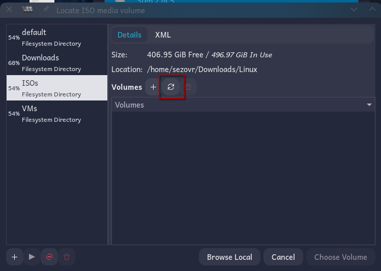
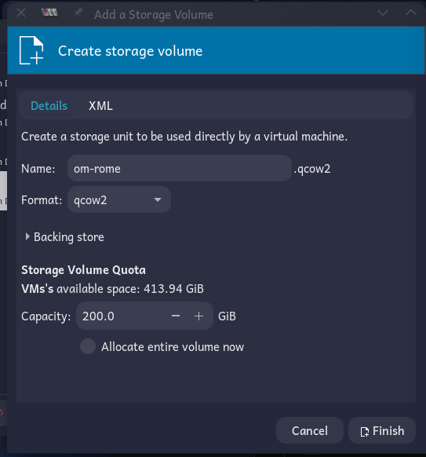
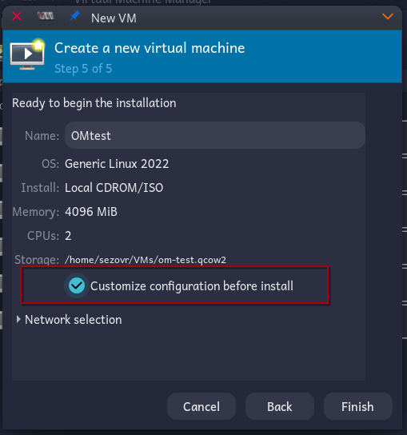
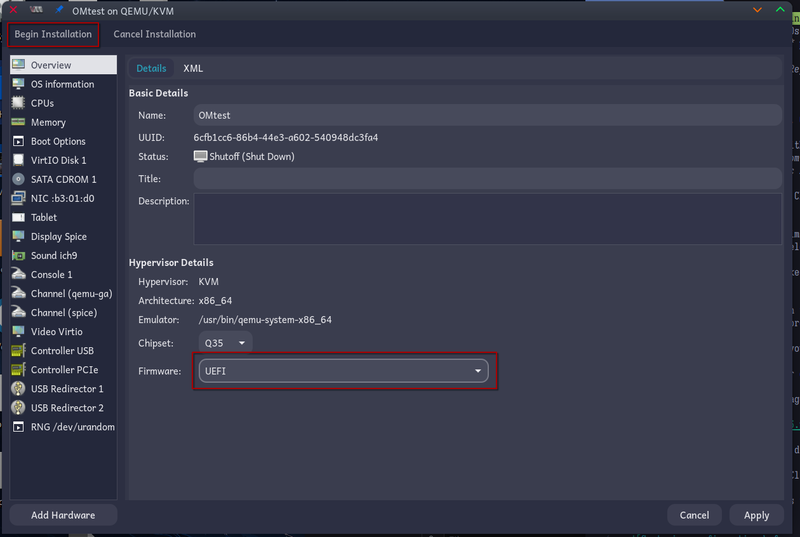
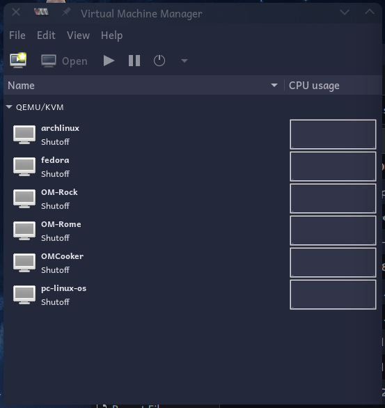

# Creating a Cooker VM

Now that Virt Manager is installed and configured, create a virtual machine running OpenMandriva Cooker. This gives you a safe, isolated environment for building and testing packages without affecting your daily system.

If you have not yet installed Virt Manager or configured storage pools, follow [Installing and Using Virt Manager](./index.en.html) first.

## Download a Cooker ISO

Cooker snapshots are published as ISO images. Download the latest build for your architecture from the official [OpenMandriva Cooker](https://www.openmandriva.org/info-cooker/) page.

## Create the VM

1. In Virt Manager, click *Create a new virtual machine* in the toolbar.

   

2. Choose *Local install media*, then click *Forward*.

3. Click *Browse*, navigate to your ISO storage pool, select the Cooker ISO you downloaded, and click *Choose Volume*.

   

4. Virt Manager cannot auto-detect OpenMandriva. De-select *Automatically detect from the installation media / source*, type *Generic*, and select *Generic Linux 2022*. Click *Forward*.

5. Choose the amount of memory and CPUs to dedicate to the VM. The defaults of 4 GB and 2 CPUs are sufficient for package building. Click *Forward*.

6. Click *Select or create custom storage*, then click *Manage...*.

7. In the storage volume dialog, select your *VMs* storage pool.

8. Click the *+* button next to *Volumes* to create a new disk image.

9. Enter a name for the disk image---for example, `cooker`.

10. Choose the disk size. A minimum of 20 GB is recommended for a development environment. Click *Finish*.

    

11. Confirm the new disk image is selected, then click *Choose Volume*.

12. Click *Forward*.

13. Enter a name for the VM---for example, `Cooker`. **Check** *Customize configuration before install*, then click *Finish*.

    

14. In the configuration editor, locate the *Firmware* drop-down at the bottom. The default is BIOS; change it to *UEFI*. Click *Begin Installation*.

    

15. The VM boots from the Cooker ISO. Proceed with the installation as you would for any OpenMandriva release.

After installation, double-click the VM in the Virt Manager window and click its *Play* button to launch it.

## Related Topics

- [Installing and Using Virt Manager](./index.en.html)
- [Preparing Your System](../preparing-your-system.en.html)
- [Using Cooker](../using-cooker.en.html)
