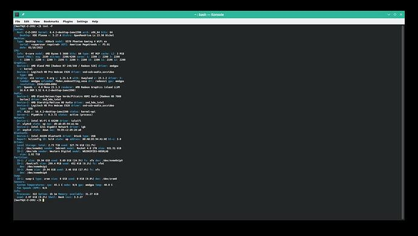
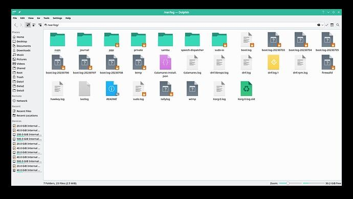
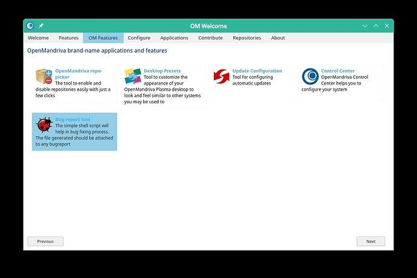
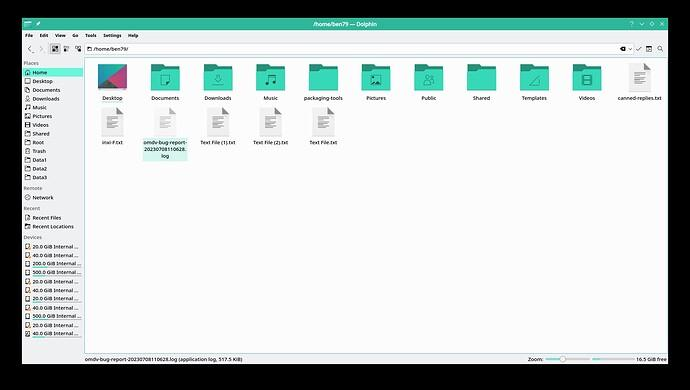
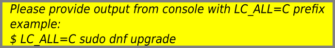

# Get Logs and Hardware Info for Issue Reports

When reporting an issue on the [forum](https://forum.openmandriva.org/) or in a [bug report](https://github.com/OpenMandrivaAssociation/distribution/issues), you may be asked to provide logs or hardware information. Use the commands below to gather what you need.

Screenshots are very helpful for people trying to help with your issue. You can post screenshots in forum posts and bug reports.

## Get Hardware Information

Open *Konsole* (terminal) and run:

```bash
$ inxi -Fz
```



Save the output to a file for your forum post or bug report:

```bash
$ inxi -Fz | tee inxi-Fz.txt
```

This displays the output on screen *and* creates a file named `inxi-Fz.txt` in your home directory.

You can find other options using `inxi --help`. People helping with a hardware-related problem may ask you to use `inxi` with different options. Modify the command as needed, changing the option from `-F` to what is requested and using any filename ending in `.txt`.

## Get System Logs

System logs are managed by `journald` and accessed with the `journalctl` command in *Konsole*. You can access them as a regular user or as root.

View all logs:

```bash
$ journalctl
```

View logs from your current boot only:

```bash
$ journalctl -b
```

Save the output to a file for your forum post or bug report:

```bash
$ journalctl | tee journalctl.txt
```

Or, for the current boot only:

```bash
$ journalctl -b | tee journalctl-b.txt
```

People helping with problems may ask you to use `journalctl` with other options. Follow the request.

## Other Useful Logs

Additional logs live in the `/var/log` directory:



The logs you most often need are:

- `dnf.log` for issues regarding `dnf` transactions.
- `Xorg.0.log` for graphics issues with the X server.

Logs or directories with an orange icon and a lock require root permissions to open. Use `su` or enter your root password to access them.

{: .note }
If you are using X server or X11, look for `xorg.session.log` in `[Home]/.local/share/sddm/` (replace `[Home]` with your actual home directory). The path may differ on desktops that use a different display manager instead of SDDM. You can access these files by gaining root privileges in *Konsole*.

{: .note }
More detailed information about logs for Wayland sessions is needed.

## Use the omv-bug-report Tool

The `omv-bug-report` tool collects comprehensive system information into a single file.

1. Open *OM-Welcome* and navigate to *OM-Features*.
2. Click the `omv-bug-report` icon.
3. Enter your root password in the dialog window.

The tool creates a file in your home directory. Scroll through the contents to see all the information it provides. Include this file in bug reports involving technical issues.





## Forum Posting Reminders

When posting in the OpenMandriva forums, keep these reminders in mind:


If your computer output is not in English, prefix commands with `LC_ALL=C`:

```bash
$ sudo LC_ALL=C dnf [command]
```



## Related Topics

- [Getting Support on the Forum](./getting-support-on-the-forum.en.html)
- [How to Report a Bug](./how-to-report-a-bug.en.html)
- [Using DNF](../index.en.html)
