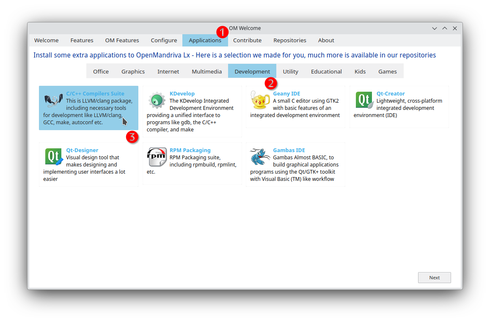

# Compile Custom Software

OpenMandriva uses *clang* as its primary compiler---a unique feature of the distribution. Since OpenMandriva 5.0, GCC has been dropped in favor of clang, and you can no longer compile kernel modules with GCC.

> **Warning:** GCC is still available but has been fully replaced by clang since OpenMandriva 5.0. It is not possible to use GCC to compile kernel modules.
{: .warning }

## Before You Compile

1. Check whether the software already exists in the repositories. Search using *DNF* or *DnfDrake* before building from source.

1. If the package is missing, you can request it through the forum or GitHub.

## Install Development Tools

1. Install the basic development tool sets from OM Welcome:

   

1. Or install them from the command line:

   ```bash
   sudo dnf install task-devel task-c-devel task-c++-devel
   ```

## Compile a Program

By default, build scripts may use GCC. Force clang by passing the appropriate compiler variables:

```bash
make CC=clang CXX=clang++ LD=ld.lld AR=llvm-ar NM=llvm-nm OBJCOPY=llvm-objcopy OBJDUMP=llvm-objdump STRIP=llvm-strip
```

## Package Your Software

If you want to go further and package software for the distribution, join the packaging team. See [How to Build and Submit Packages](../../dev/how-to-build-and-submit-packages.en.html) for instructions.

## Related Topics

- [Maintaining Your System](../maintaining-your-system.en.html)
- [How to Build and Submit Packages](../../dev/how-to-build-and-submit-packages.en.html)
