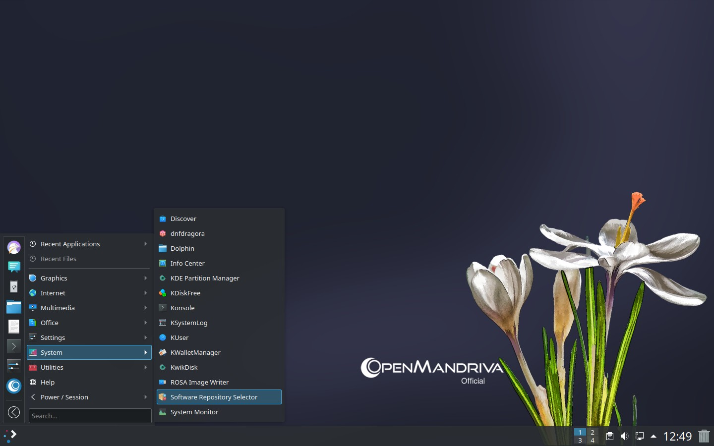
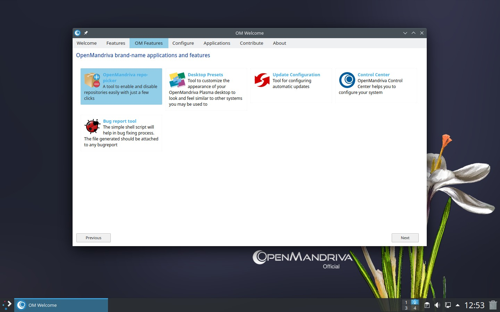
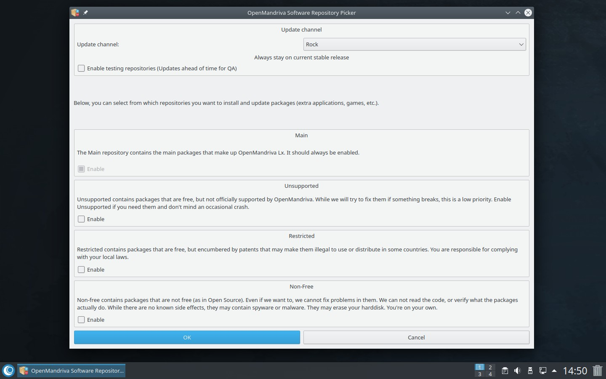
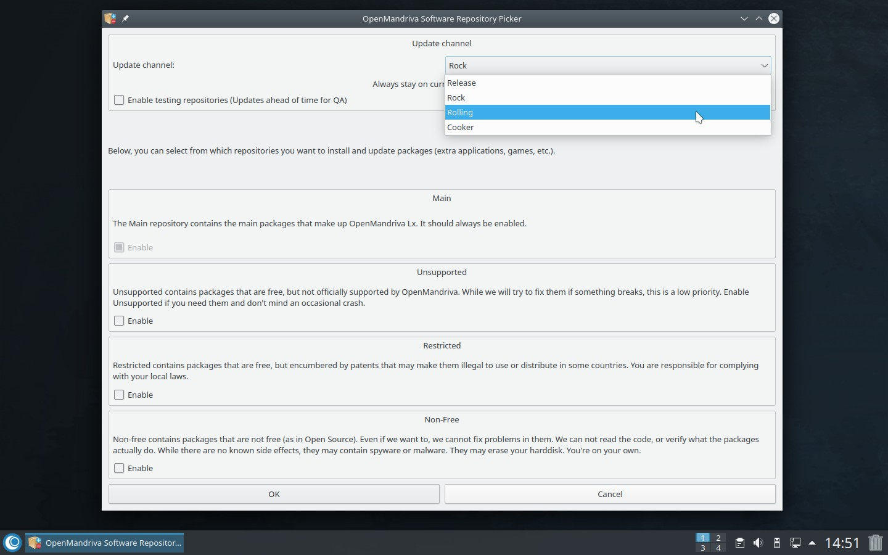

# Switch Update Channels

OpenMandriva offers two main release branches: *Rock* (stable) and *ROME* (rolling). If you want to switch from Rock to ROME---or vice versa---update your repository channel and run a system upgrade.

> **Note:** As a ROME user, you should be comfortable with the command line and familiar with basic DNF commands. Read [Release Plan and Repositories](../../community/releases/index.en.html) before switching.
{: .note }

## Switch from Rock to ROME

1. Open *Software Repository Selector* (`om-repo-picker`) from the application menu, or open it from OM Welcome.

   

1. In OM Welcome, select the OpenMandriva repo-picker.

   

1. Navigate to the *Update channel* section.

   

1. Select *Rolling* from the dropdown menu, confirm with *OK*, and enter your root password when prompted.

   

   This changes your repositories from Rock to Rolling. The window may disappear briefly---wait for the process to finish.

1. Run a system upgrade to apply the changes:

   ```bash
   $ sudo dnf clean all ; dnf clean all ; dnf repolist
   $ sudo dnf --allowerasing distro-sync
   ```

## Switch from ROME to Rock

To go back to Rock, you must reinstall the distribution. Back up your data first, then install the latest Rock ISO.

## Related Topics

- [Managing Software](../managing-software.en.html)
- [Update Your System](./index.en.html)
