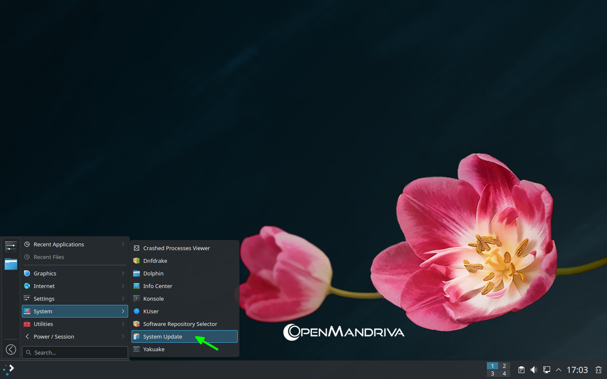
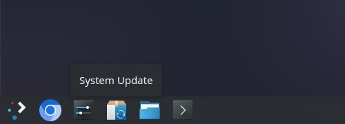
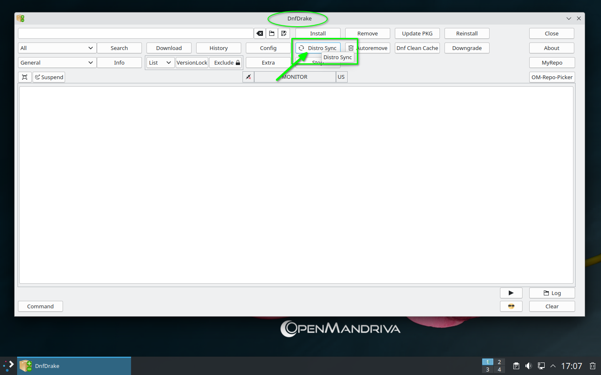
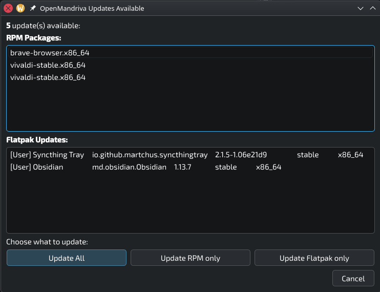

# Update Your System

*DNF* manages all system updates on OpenMandriva. Don't use *Discover* for system upgrades; use one of the methods below instead.

## Update from the Command Line

Use the command line when you need full control over the update process or when no graphical environment is available.

1. Open *Konsole* and refresh the package lists:

   ```bash
   $ sudo dnf clean all ; dnf clean all ; dnf repolist
   ```

1. Sync your system to the latest packages:

   ```bash
   $ sudo dnf distro-sync --refresh --allowerasing
   ```

## Update Using the Graphical Menu

Check for and install updates through the desktop's graphical update menu.



## Update Using Task Manager

Monitor and manage background update tasks through the Task Manager.



## Update Using DnfDrake

Use *DnfDrake* for a graphical interface to *DNF*. See [DnfDrake Overview](/user-guide/managing-software/dnfdrake-overview/) for details.



## Update Using the OpenMandriva Updater

Use the *OpenMandriva Updater* for automatic background checks and desktop notifications. See [OpenMandriva Updater](/user-guide/managing-software/openmandriva-updater/) for details.



## Related Topics

- [Maintaining Your System](/user-guide/maintaining-your-system/)
- [DnfDrake Overview](/user-guide/managing-software/dnfdrake-overview/)
- [OpenMandriva Updater](/user-guide/managing-software/openmandriva-updater/)
- [Switch Update Channels](/user-guide/maintaining-your-system/switch-update-channels/)
