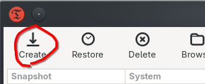
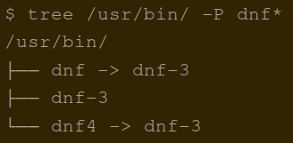
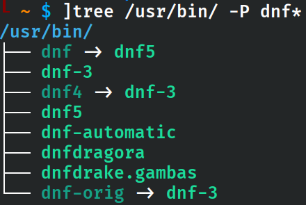
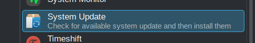
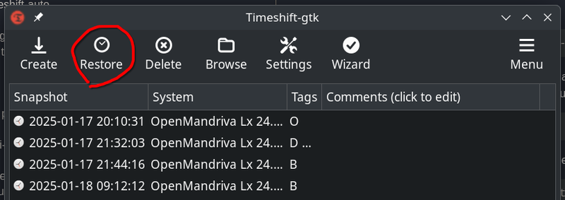

# Using Timeshift for System Snapshots

*Timeshift* creates system snapshots so you can roll back after a failed update or a broken driver. You can make Timeshift snapshot the system whenever you install, update, or remove packages. This requires *DNF5* and the `timeshift-autosnap-dnf5` plugin.

## Install Timeshift

Install the package:

```bash
sudo dnf install timeshift
```

Open Timeshift from the application menu. The setup wizard runs on first launch and configures the essential functions.

## Enable Scheduled Snapshots

Timeshift relies on `crond` for scheduled snapshots. Enable and start the service:

```bash
sudo systemctl enable --now crond.service
```

Timeshift then runs the schedule you configured in the wizard.

## Create Your First Snapshot

Create at least one snapshot before proceeding. Timeshift needs a baseline for later recovery steps.



## Choose a File System Mode

Timeshift works on *EXT4*, *XFS*, and *Btrfs*. On any of these file systems, it can use `rsync` to copy system files. `rsync` snapshots are reliable but large. On Btrfs, Timeshift can use native snapshots instead. Btrfs snapshots are fast and small because Btrfs stores only changed data.

For a walkthrough of recovery, see the [system recovery video](https://odysee.com/@EF-TechMadeSimple:3/system-recovery-with-timeshift-and:c).

## Install DNF5

{: .note }
Only install DNF 5 if you're on OpenMandriva Lx Rock. OpenMandriva ROME and OpenMandriva Cooker already have DNF5 by default. Skip to the next section if you already have DNF5.

Install DNF5:

```bash
sudo dnf install dnf5
```

After installing DNF5, all future package transactions must use `sudo dnf5`. Some system tools still call `dnf` and won't trigger snapshots. Choose one of the following methods to make `dnf` invoke DNF5.

### Option 1: Alias dnf to dnf5

Add aliases to your shell configuration:

```bash
echo 'alias dnf="dnf5"' >> /home/$USER/.bashrc
echo 'alias sudo="sudo "' >> /home/$USER/.bashrc
exec bash
```

The first alias makes `dnf` run `dnf5`. The second lets `sudo` recognize aliases. Run `exec bash` in other open terminals to reload them.

Aliasing doesn't always catch every `dnf` call from system tools.

### Option 2: Replace the dnf Symlink System-Wide

{: .warning }

This method is not an official OpenMandriva suggestion. After you set up your system, some tools, such as the repository picker, may not respond properly. Aliasing doesn't have this effect. Choose carefully.

When you run `dnf`, you invoke a symlink chain, not a binary directly. Inspect it:

```bash
cd ~ && tree /usr/bin/ -P dnf*
```

You should see `dnf` pointing through `dnf4` to `dnf-3`.



Replace the symlink so `dnf` points to `dnf5`:

```bash
cd /usr/bin && sudo mv dnf dnf-orig && sudo ln -s dnf5 dnf
```

This backs up the original symlink as `dnf-orig` and routes all `dnf` calls to DNF5.



Do not use both aliasing and the symlink method.

## Install the Snapshot Plugin

Install the build tools:

```bash
sudo dnf install git make
```

Clone the plugin repository:

```bash
git clone https://github.com/CalliopeSystem/timeshift-autosnap-dnf5.git
```

Build and install it:

```bash
cd /home/$USER/timeshift-autosnap-dnf5
sudo make install
```

## Configure Snapshot Retention

By default, the plugin keeps 3 snapshots. To keep more, edit its configuration:

```bash
sudo nano /etc/timeshift-autosnap-dnf5.conf
```

Set `maxSnapshots` to your preferred value:

```bash
maxSnapshots=10
```

Save and exit.

Timeshift now snapshots the system on every package change.

## Caveats

*DnfDrake* and *DNFDragora* use internal DNF binaries and don't trigger snapshots. The OpenMandriva system updater and terminal updates work.



## Bootable Snapshots in GRUB

On Btrfs, you can expose Timeshift snapshots as boot entries in GRUB and boot an older snapshot when an update makes the system unbootable.

Complete the previous steps first. Then install the required packages:

```bash
sudo dnf install btrfs-progs gawk inotify-tools grub-btrfs
```

Edit the grub-btrfs configuration:

```bash
sudo nano /etc/default/grub-btrfs/config
```

Uncomment lines 101, 133, and 139:

```text
GRUB_BTRFS_GRUB_DIRNAME="/boot/grub2"
GRUB_BTRFS_MKCONFIG=/usr/bin/grub2-mkconfig
GRUB_BTRFS_SCRIPT_CHECK=grub2-script-check
```

Edit the grub-btrfsd service:

```bash
sudo systemctl edit --full grub-btrfsd
```

Replace this line

```text
ExecStart=/usr/bin/grub-btrfsd --syslog /.snapshots
```

with this line

```text
ExecStart=/usr/bin/grub-btrfsd --syslog --timeshift-auto
```

Reload systemd and enable the service:

```bash
sudo systemctl daemon-reload
sudo systemctl enable --now grub-btrfsd
```

Regenerate the GRUB configuration:

```bash
sudo /etc/grub.d/41_snapshots-btrfs
sudo grub2-mkconfig -o /boot/grub2/grub.cfg
sudo /etc/grub.d/41_snapshots-btrfs
```

Reinstall GRUB:

```bash
sudo grub2-install --boot-directory=/boot --efi-directory=/boot/efi
```

A new OpenMandriva Lx Snapshots entry appears at the bottom of the GRUB menu.

## Boot from a Snapshot

Booting into a Timeshift snapshot loads a working system, but the snapshot is not read-only. Changes you make in that state disappear on reboot. Boot into the snapshot to verify it works, then restore it permanently.

1. Boot and select the snapshot from the *OpenMandriva Lx Snapshots* GRUB entry.
2. Verify the system works.
3. Open Timeshift, select the snapshot, and restore it.

On reboot, you return to a fully working system.



## Related Topics

- [Maintaining Your System](/user-guide/maintaining-your-system/)
- [Update Your System](/user-guide/maintaining-your-system/update-your-system/)
- [Switch Update Channels](/user-guide/maintaining-your-system/switch-update-channels/)
- [First Ten Tasks After Installation](/user-guide/first-steps/)
- [Partitioning](/getting-started/installing-openmandriva/partitioning/)
