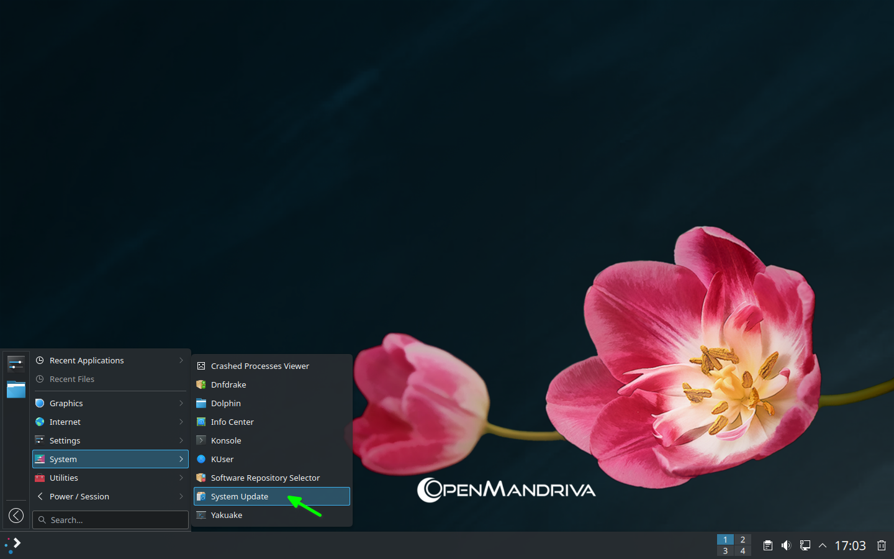
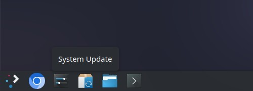
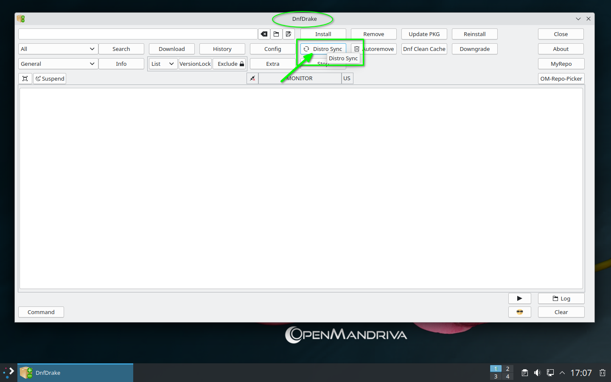

# Update Your System

OpenMandriva's package manager (*DNF*) handles all system updates. Unlike some distributions, you should **not** use *Discover* for system upgrades---use one of the methods below instead.

## Update from the Command Line

1. Open *Konsole* and refresh the package lists:

   ```bash
   $ sudo dnf clean all ; dnf clean all ; dnf repolist
   ```

1. Sync your system to the latest packages:

   ```bash
   $ sudo dnf distro-sync --refresh --allowerasing
   ```

## Update Using the Graphical Menu

Alternatively, you can update using a graphical tool:



## Update Using Task Manager

Or use the task manager interface:



## Update Using DnfDrake

Or use *DnfDrake*---see [DnfDrake Overview](../software/dnfdrake.en.html) for details:



## Related Topics

- [Maintaining Your System](./index.en.html)
- [Switch Update Channels](./update-channel.en.html)
