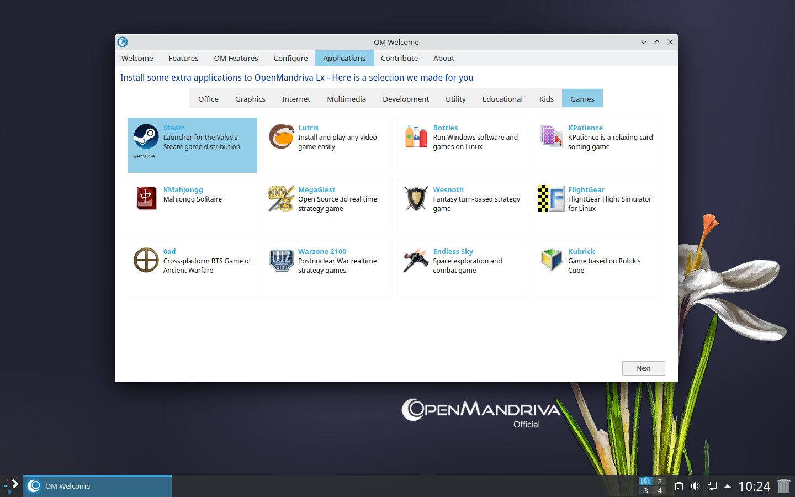
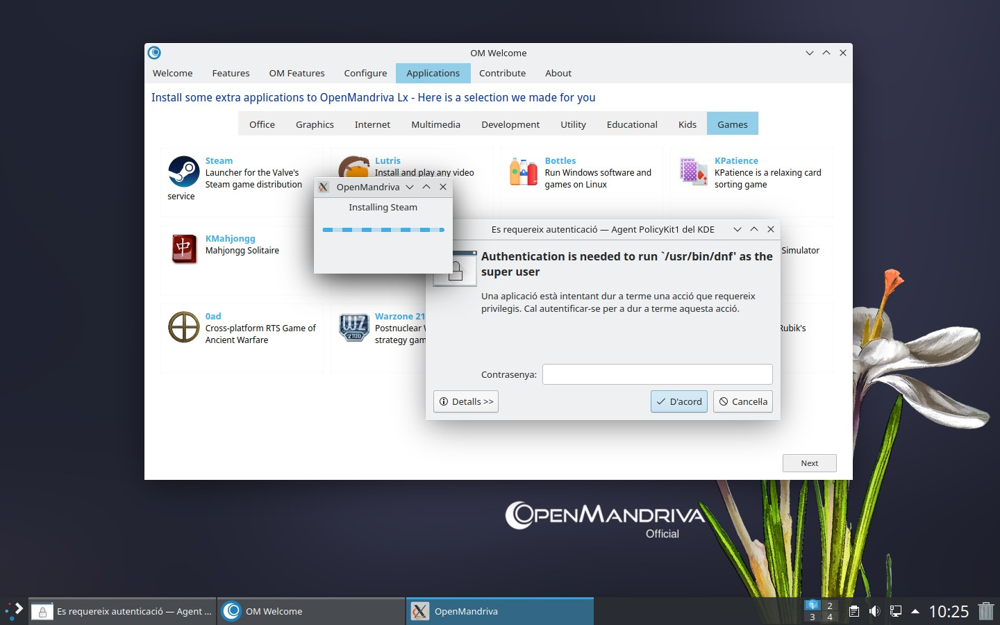
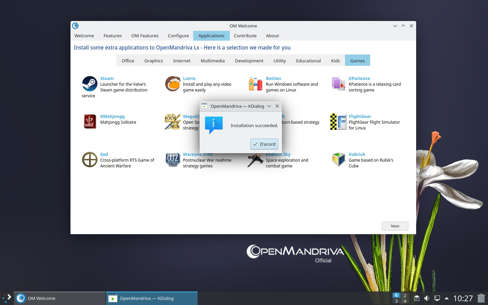

# Installing Steam

Steam is a popular digital distribution platform for games. OpenMandriva includes Steam in its repositories---you can install it through OM Welcome or the application menu.

## Install Through OM Welcome

1. Open *OM Welcome*.

1. Navigate to *Applications > Games*.

1. Click *Steam*.







### NVIDIA Graphics Driver

If you use an NVIDIA graphics card, install the 32-bit version of the driver so Steam can run 32-bit games. Make sure you have enabled the *non-free* repository in the [Software Repository Selector](/user-guide/managing-software/software-repository-selector/). 

```bash
$ sudo dnf install nvidia-32bit
```

For older NVIDIA cards, use the legacy driver instead:

```bash
$ sudo dnf install nvidia-legacy-32bit
```

## Related Topics

- [Managing Software](/user-guide/managing-software/)
- [Using DNF](/user-guide/managing-software/using-dnf/)
