# OM Welcome

*OM Welcome* is the first thing you see on your desktop at each boot. It is not just a greeting screen---it is a configuration hub that introduces the distribution, its features, and its tools. You can disable it from starting automatically if you prefer.

## Welcome Screen

The first screen introduces OpenMandriva, the community behind it, and the values the distribution is built on. All screens are accessible via direct links in the top bar. Near the bottom, you can disable OM Welcome from starting at boot.

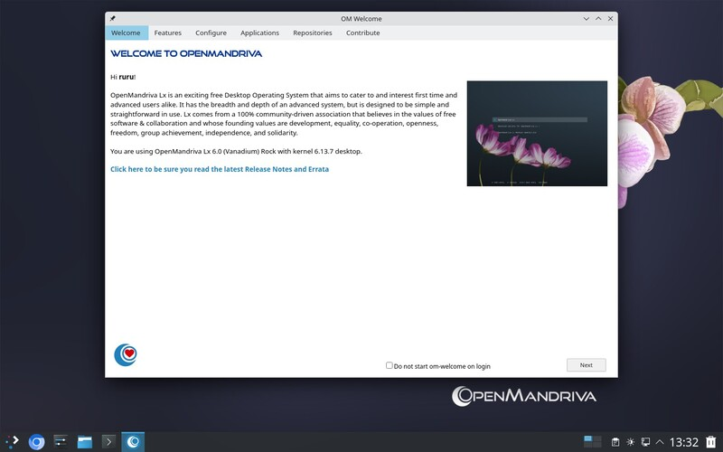

Click *Next* to continue.

## Features

The second screen shows the key technical features of OpenMandriva Lx and introduces distribution-specific applications.

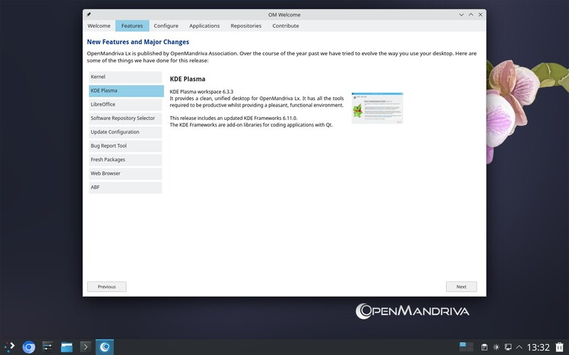

Click *Next* to continue.

## Configure

This screen gives you quick access to system configuration tools. The options cover:

- **System**---power management, display, and updates
- **Hardware**---printer, Bluetooth, and peripheral configuration
- **Software**---package management and repositories
- **Desktop**---appearance, themes, and panel settings
- **Security**---firewall and privacy settings

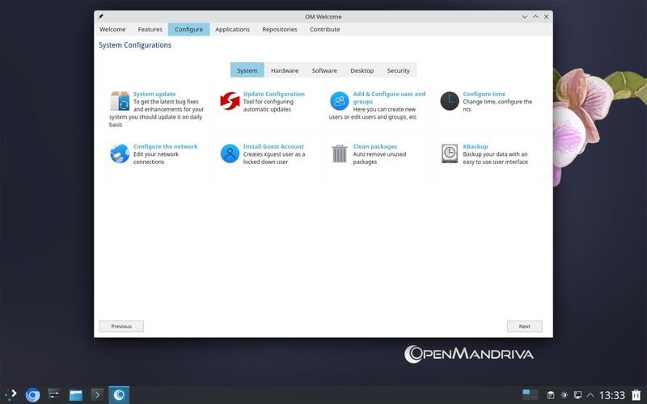

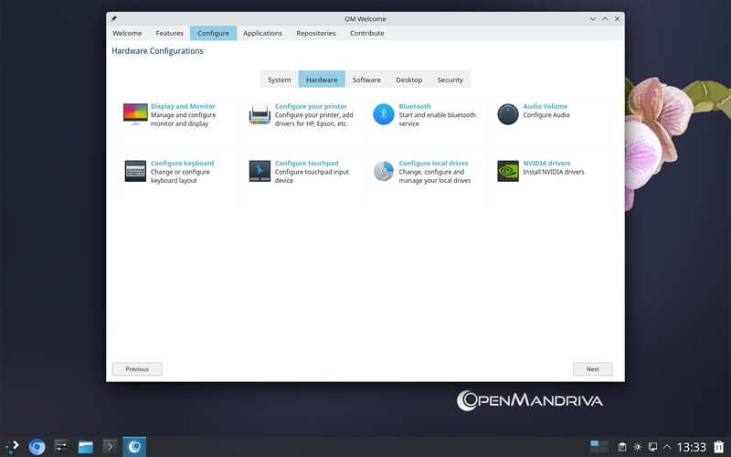

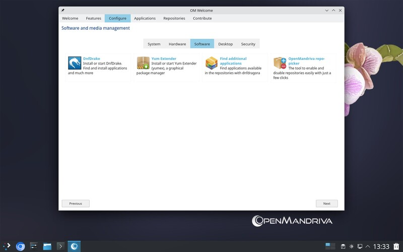

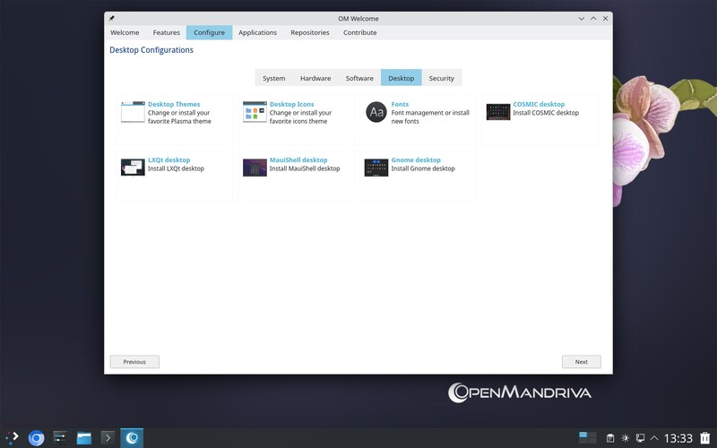

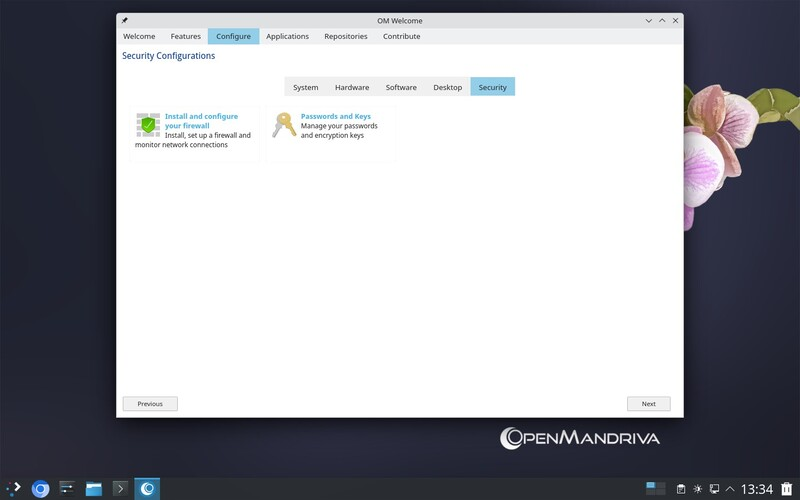

Click *Next* to continue.

## Applications

This screen helps you install commonly used applications by category---browsers, office suites, graphics tools, multimedia players, and more. Select the applications you want and click *Install* to add them to your system.

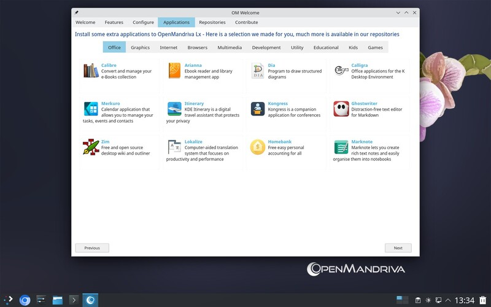

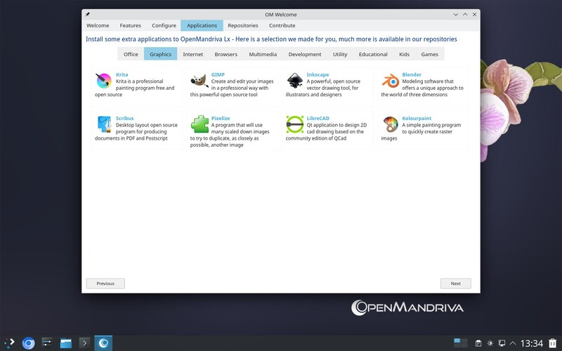

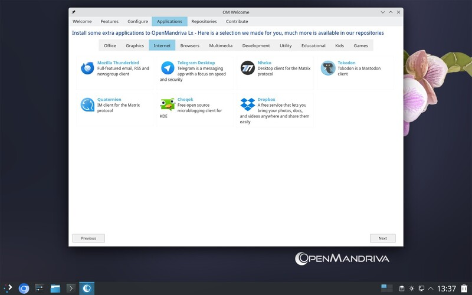

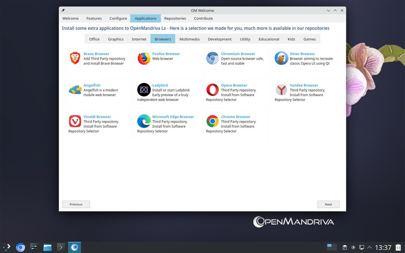

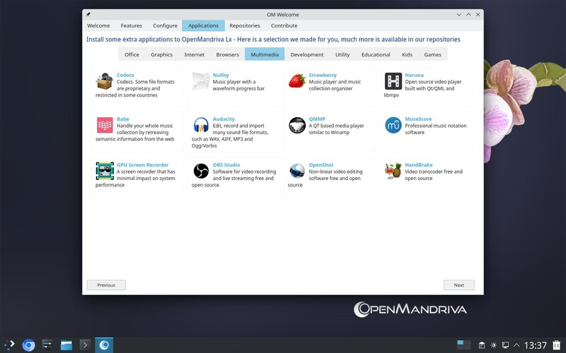

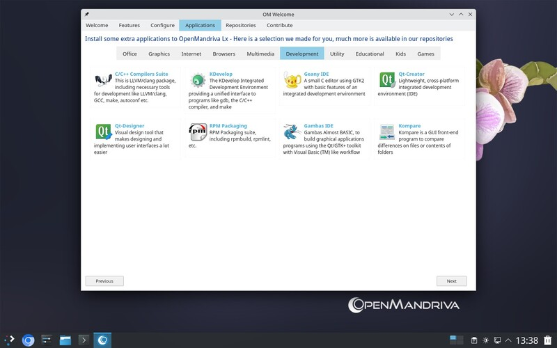

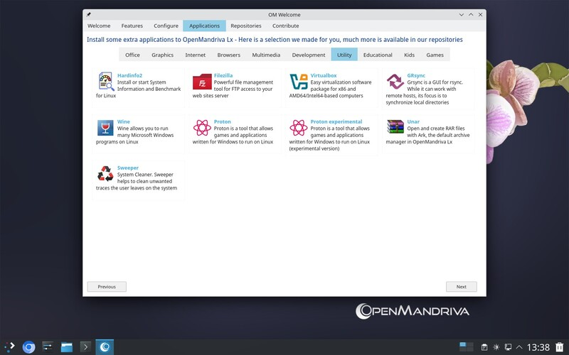

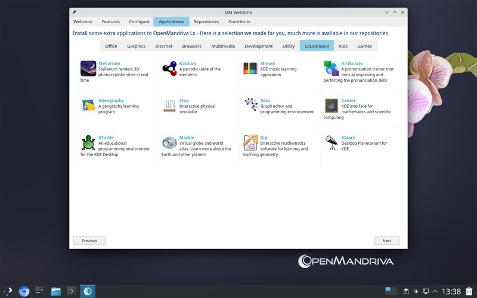

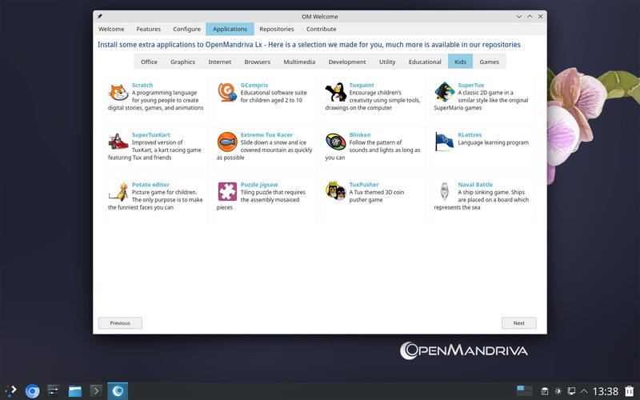

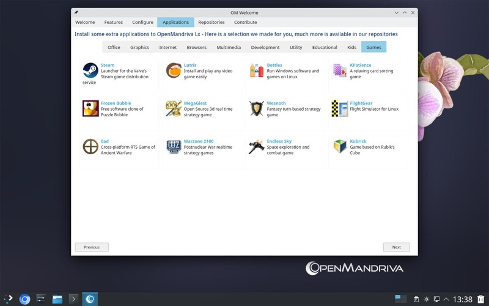

Click *Next* to continue.

## Repositories

This screen gives an overview of the different OpenMandriva software repositories---Main, Extra, Restricted, and Non-Free. Read about what each one contains and manage your repository selection.

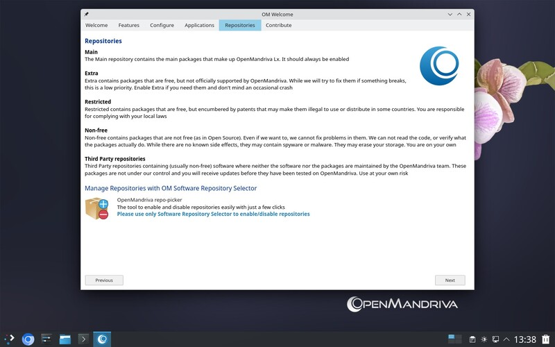

Click *Next* to continue.

## Contribute

The final screen links to the broader OpenMandriva world. From here you can reach the forum, the contributing page, social media, and other community resources.

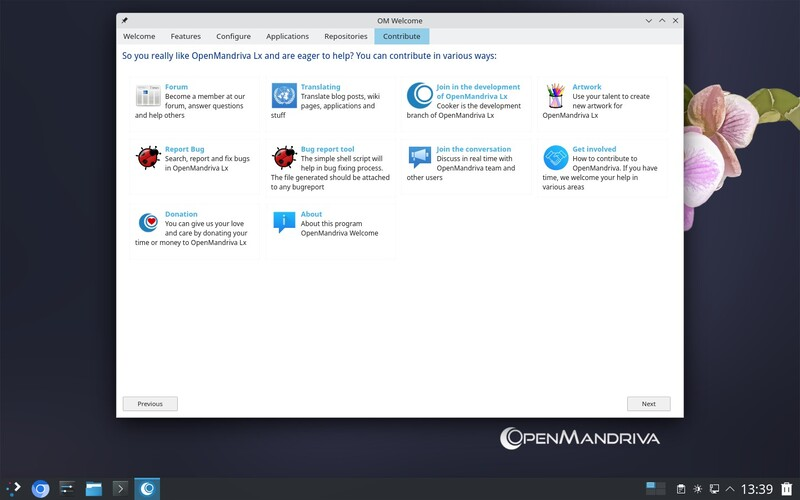

## Related Topics

- [First Ten Tasks After Installation](../first-steps.en.html)
- [Software Repository Selector](./software-repository-selector.en.html)
- [Setting Up a Printer](../post-installation-configuration/configure-a-printer.en.html)
