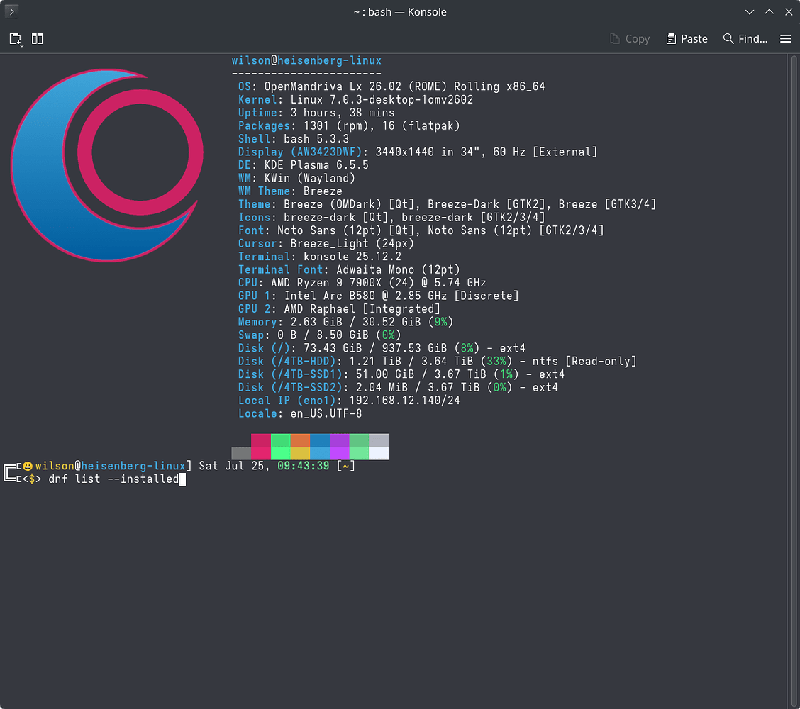
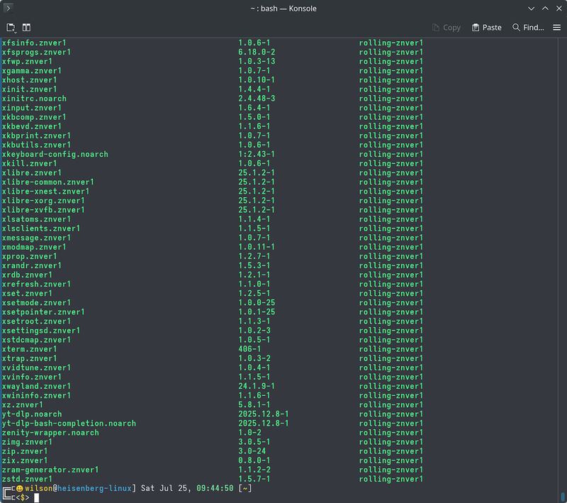
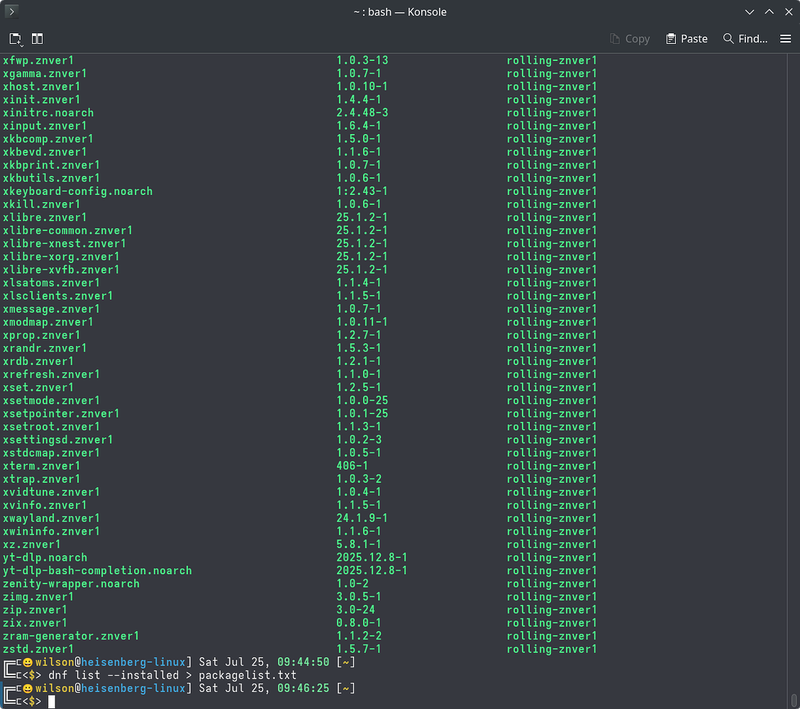
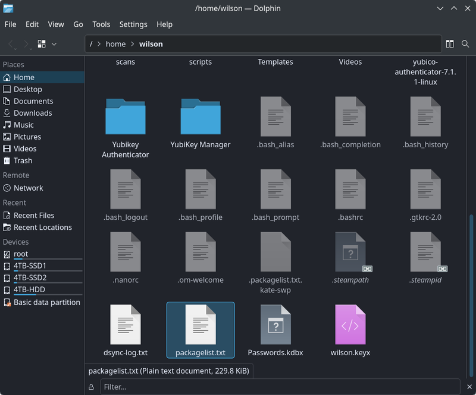
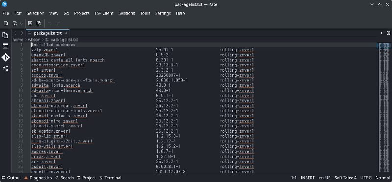
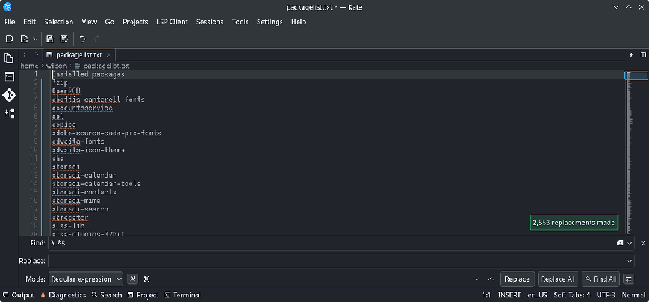
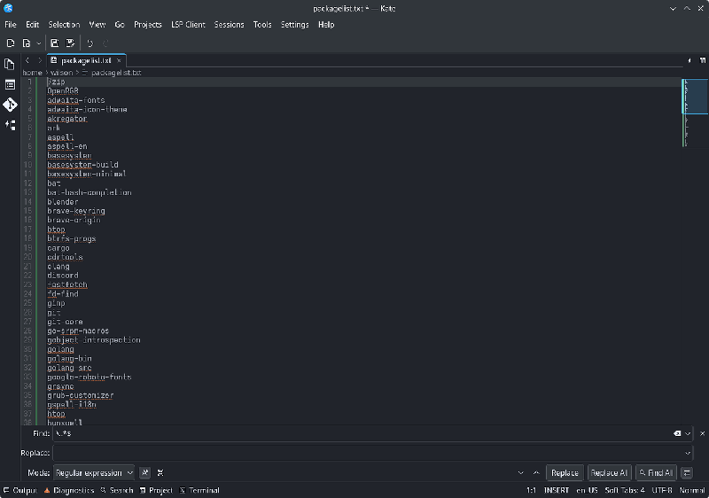
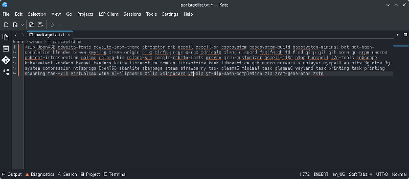
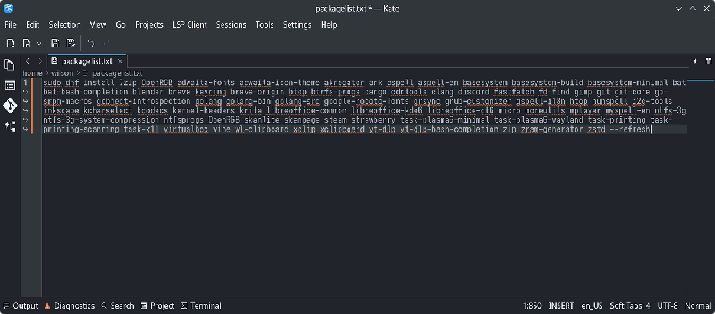

# Create an Install Command from a Package List

Generate a list of all installed packages and turn it into a single `dnf install` command you can run on a fresh installation.

## Generate the Package List

1. Run this command in a terminal to list all installed packages:

   ```bash
   $ dnf list --installed
   ```

   The output is long and difficult to work with directly.

   

   

2. Save the list to a text file in your home directory:

   ```bash
   $ dnf list --installed > ~/packagelist.txt
   ```

   No output appears on screen; the command creates `packagelist.txt` in your home directory.

   

3. Open `~/packagelist.txt` in *Kate*. The file contains package names along with version numbers, architecture, and repository information that is not useful for reinstalling.

   

   

## Clean the Package List

1. In Kate, open the *Find and Replace* tool using `Ctrl+R`.

2. Enable the *Regular expression* option.

3. In the **Find** field, enter `\..*$` and leave the **Replace** field empty.

4. Click *Replace All*.

   

   This removes the version number, architecture, and repository from each line, leaving only package names.

   Most of these packages are installed automatically from the ISO. Manually remove any lines for packages you do not need. If you leave a package in the list that is already installed on the new system, DNF skips it automatically.

   

## Build the Install Command

1. Select all text, then choose *Selection > Join Lines* using `Ctrl+J` to combine all package names into a single line.

   

2. Prepend `sudo dnf install ` to the start of the line and append `--refresh` at the end:

   ```bash
   sudo dnf install [package-name-1] [package-name-2] [package-name-3] --refresh
   ```

   

## Related Topics

- [Listing Installed Packages](/user-guide/managing-software/tips-and-tricks/listing-installed-packages/)
- [List the Latest Updates](/user-guide/managing-software/tips-and-tricks/list-the-latest-updates/)
- [Using DNF](/user-guide/managing-software/using-dnf/)
