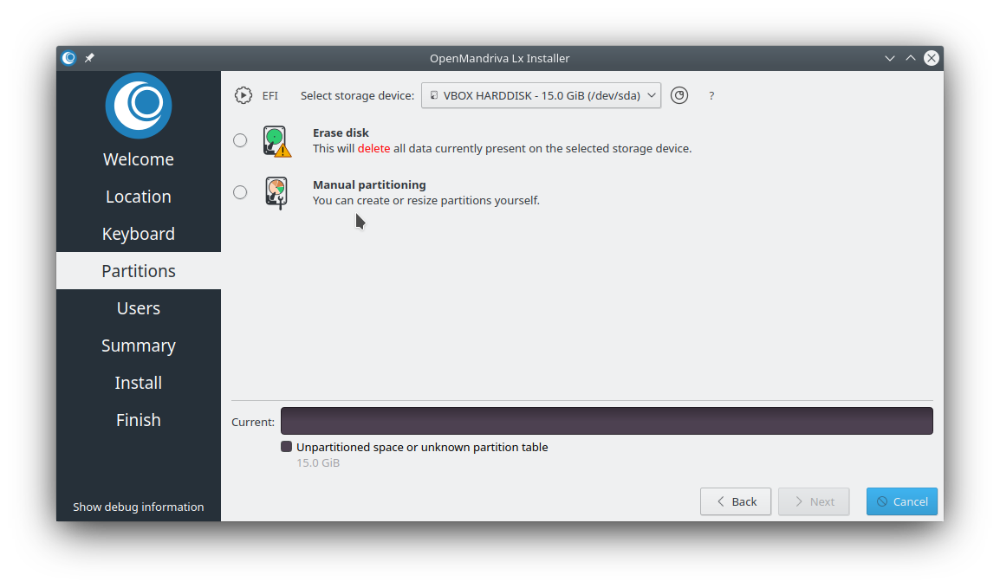
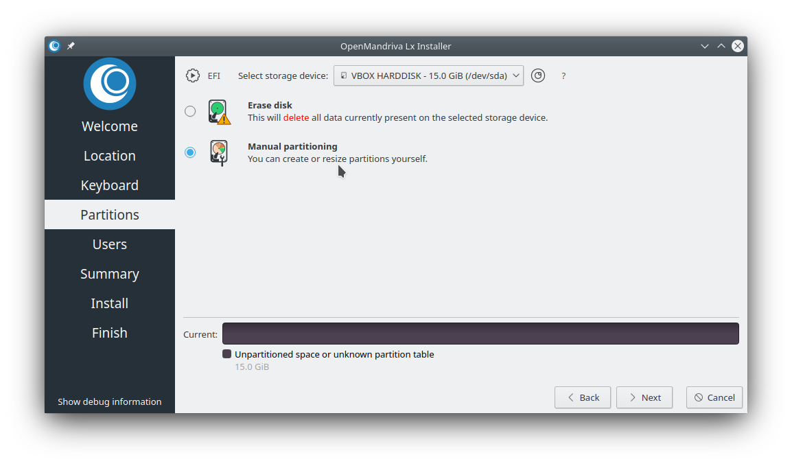
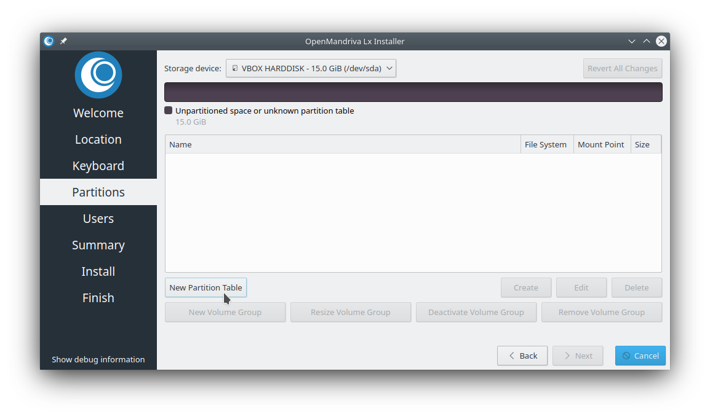
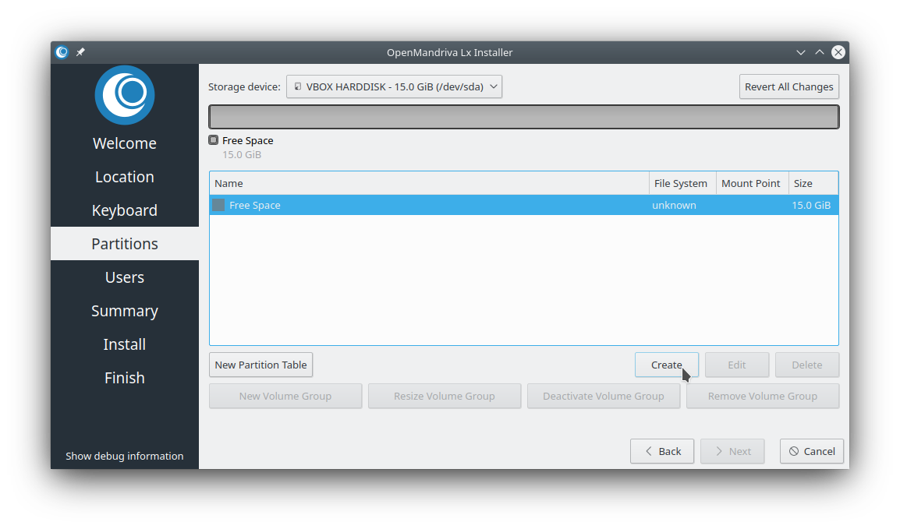
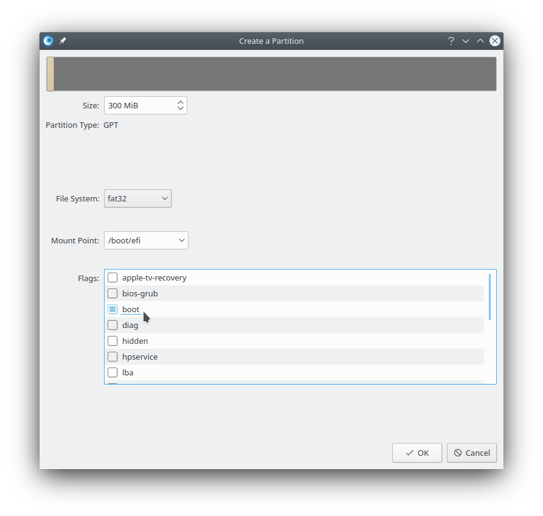
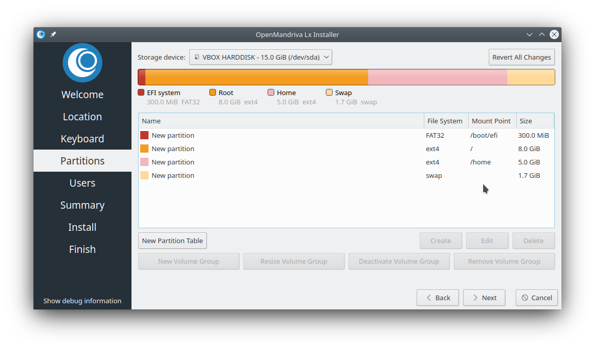

# Create Root, Home, and Swap Partitions

The OpenMandriva installer uses *Calamares*, which provides both manual and automated partitioning. When the default automated setup does not meet your needs, use manual partitioning to define separate root (`/`), home (`/home`), and swap partitions.

> **Note:** When you read *Lx 4*, it refers to all 4.x versions, including 4.0, 4.1, and 4.2. This guide applies to all versions of OpenMandriva, including Cooker and ROME.
{: .note }

## Select Manual Partitioning

To control your partition layout, select *Manual Partitioning*.

Accepting the default *Erase disk* option creates only `/boot/efi` and `/` partitions. The installer no longer creates a swap partition by default, since most modern systems do not need one.

## Create the Partition Table

1. Create a partition table. For EFI or UEFI boot, use `GPT`. For legacy boot, you can use either `MBR` or `GPT`---if you are unsure, choose `GPT`.

1. If your system has multiple drives or SSDs, they must all use the same partition table type---all `GPT` or all `MBR`.

   

## Add Partitions in Order

The only requirement is that `/boot/efi` comes first; the remaining partitions can be in any order.

1. Create the `/boot/efi` partition---typically 300 MB, formatted as FAT16 or FAT32 (the partitioner labels it `esp`).

1. Create the `/` (root) partition---this is where the operating system installs.

1. Create the `/home` partition---this stores your personal data separately from the system.

1. Create the swap partition---used as overflow memory.

1. Select *Create* for each partition and follow the dialog steps.

   

1. The completed layout should look like this.

   

When satisfied, select *Next* to begin installation.

## Swap Partition Considerations

> **Note:** Your swap partition will probably never be used. Only a small minority of users need swap---those running very old computers with limited RAM or performing intense mathematical or scientific calculations. Most users should have at least 4 GB of RAM. If your computer is short on memory, consider upgrading it.
{: .note }

## Related Topics

- [Post Installation Configuration](./index.en.html)
- [Installing OpenMandriva](../../getting-started/installing-openmandriva.en.html)
