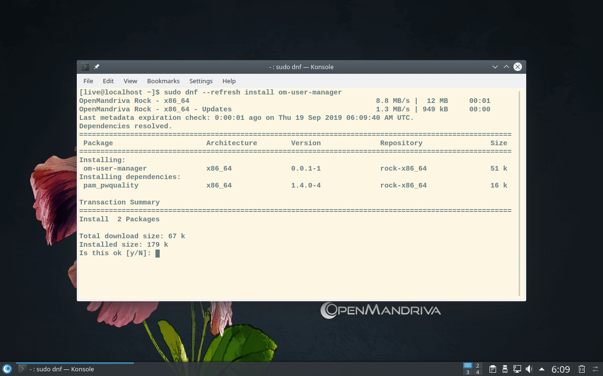
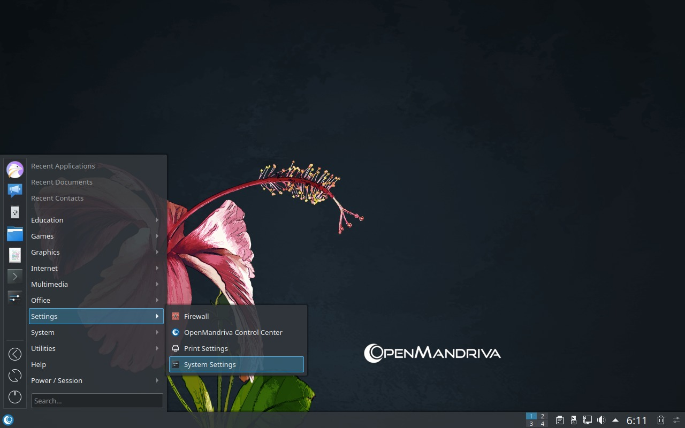
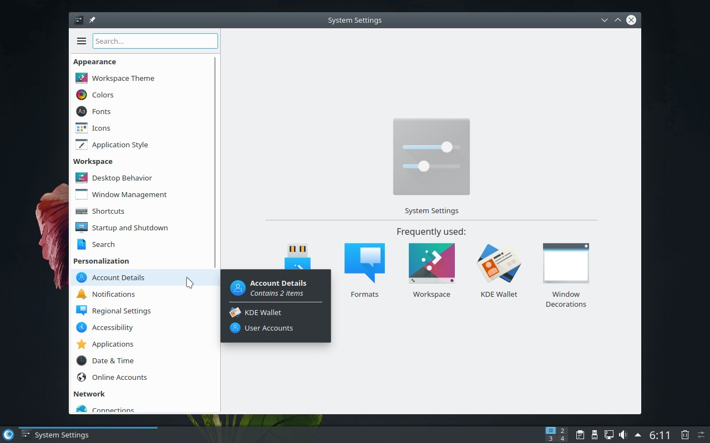
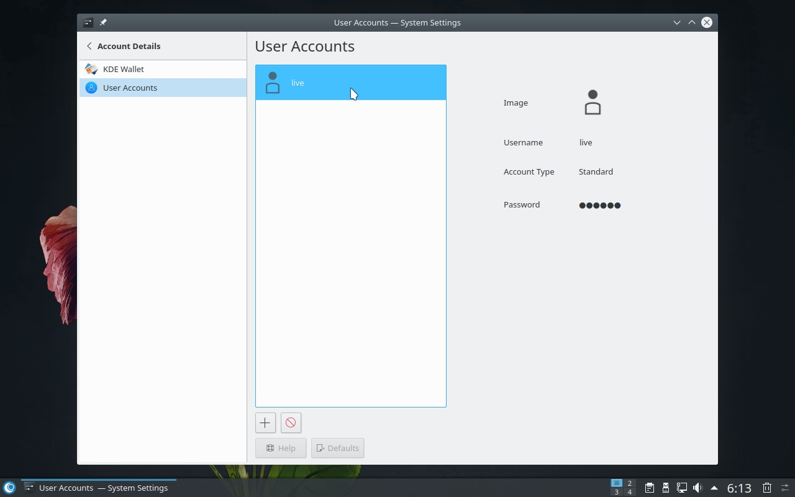
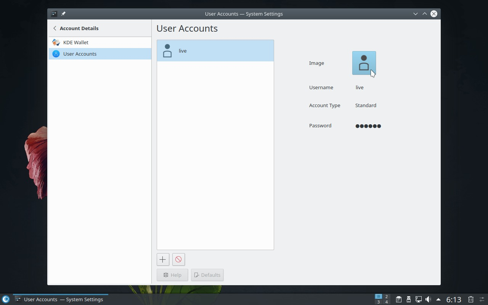
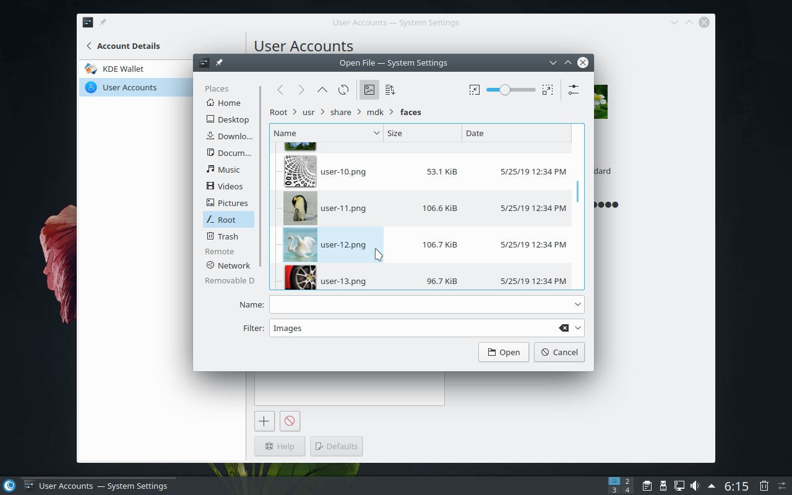
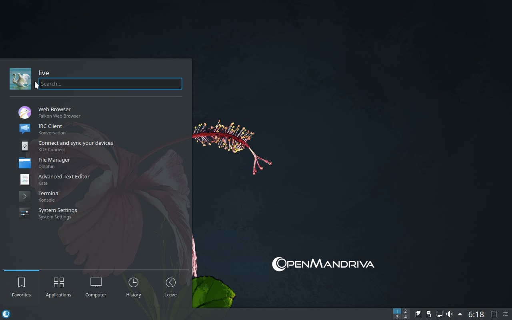
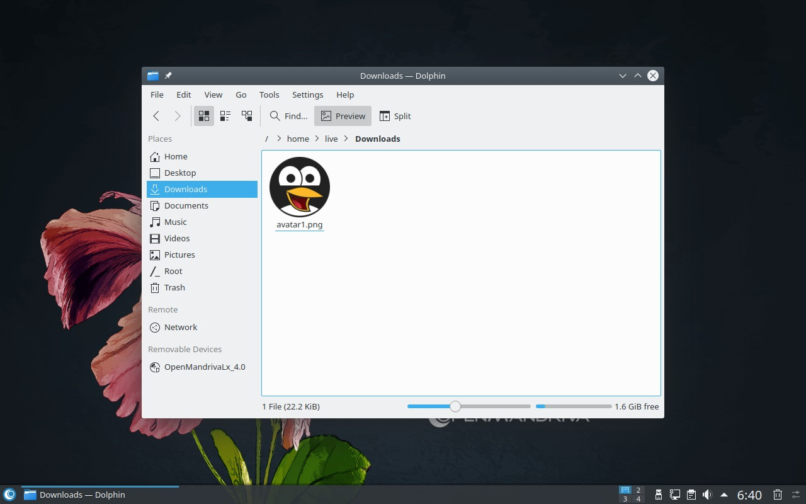
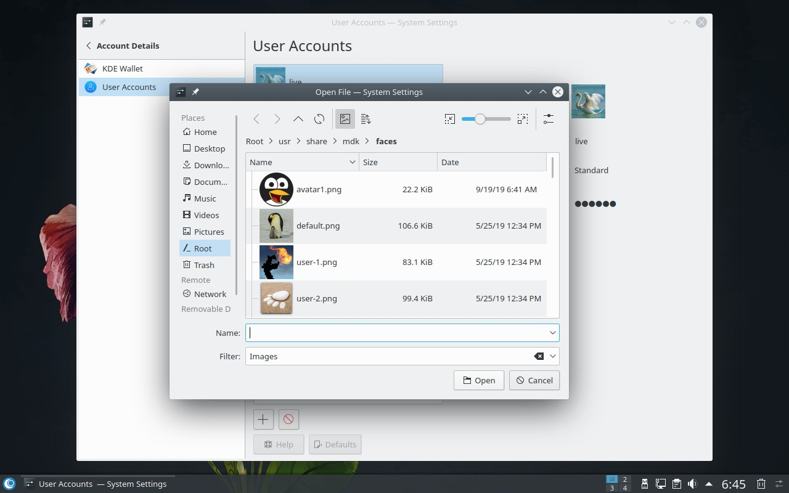

# Set Your User Avatar

The user avatar is the picture that represents your account in the login screen, user switcher, and system settings. You can choose from default images or upload a custom picture.

First, verify that the `om-user-manager` package is installed:

```bash
$ rpm -q om-user-manager
```

If the command returns no output, install the package:

```bash
$ sudo dnf --refresh install om-user-manager
```



## Set Your Avatar

1. Open *System Settings*.

   

1. Navigate to *Account Details > User Account*.

   

1. Click your username to reveal avatar options.

   

1. Click the default user image to open the avatar selection dialog.

   

1. Browse the available images. Adjust the icon size to see all options more easily, then pick one you like.

   

1. Apply the changes.

   > **Warning:** You will be asked for your root password before leaving the settings.
   {: .warning }

   

## Use a Custom Image

To use a custom image as your avatar:

1. Place the image file in `/usr/share/mdk/faces/`:

   ```bash
   $ sudo cp [your-image.jpg] /usr/share/mdk/faces/
   ```

   

1. Return to *System Settings > Account Details > User Account*, click your avatar, and select your custom image.

   

## Related Topics

- [Post Installation Configuration](./index.en.html)
- [Maintaining Your System](../maintaining/index.en.html)
