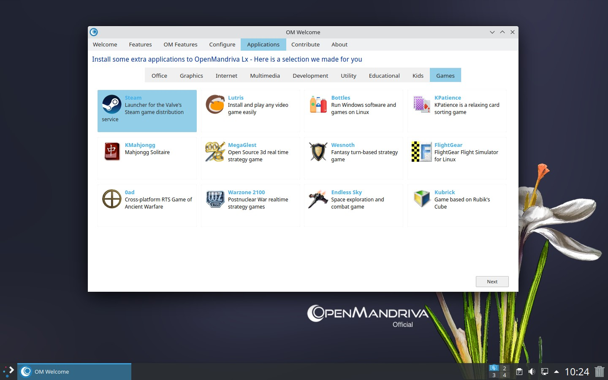
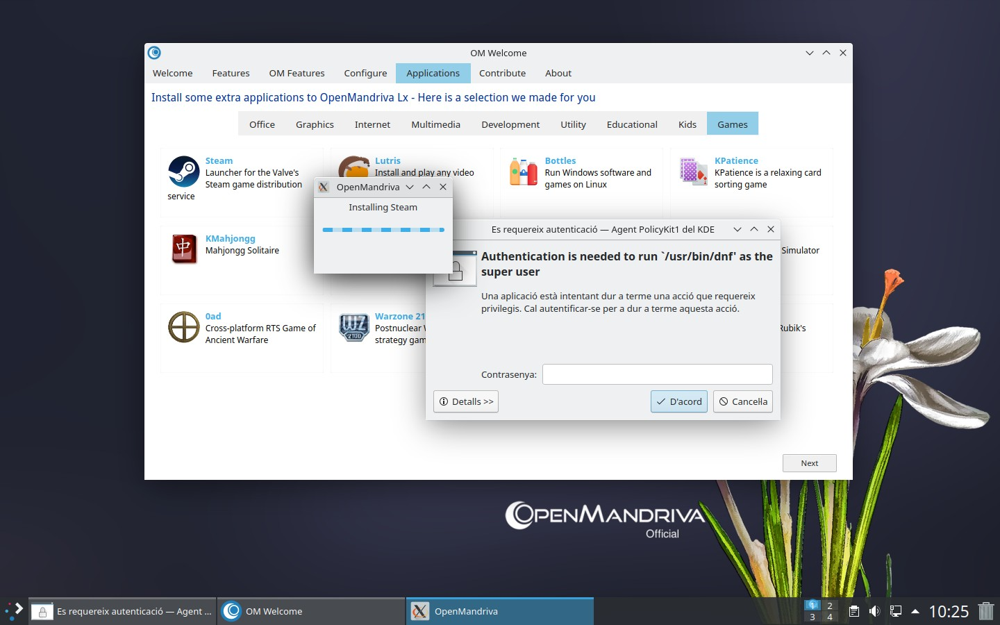
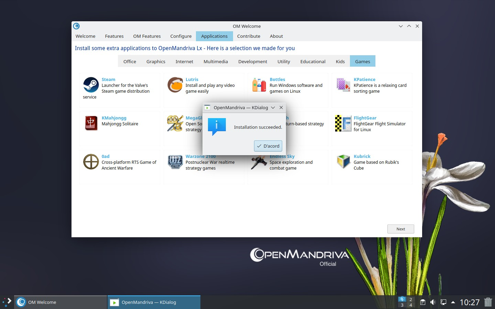
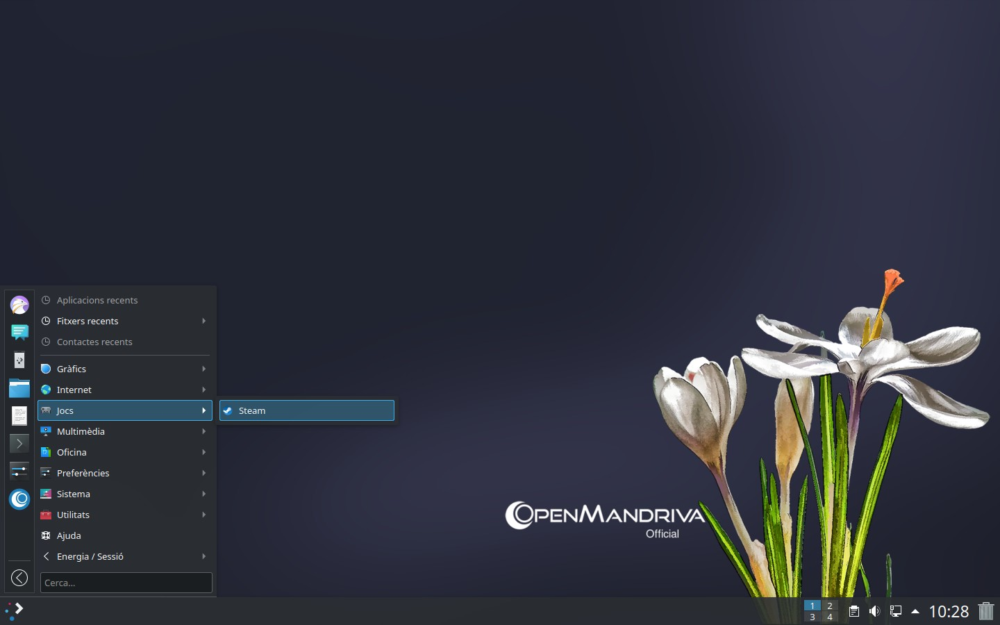
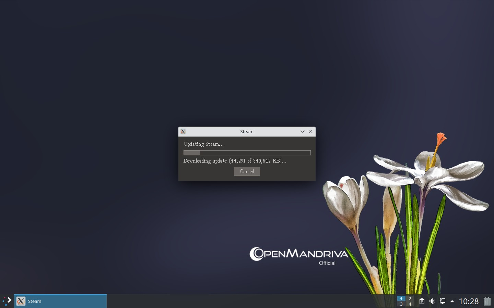
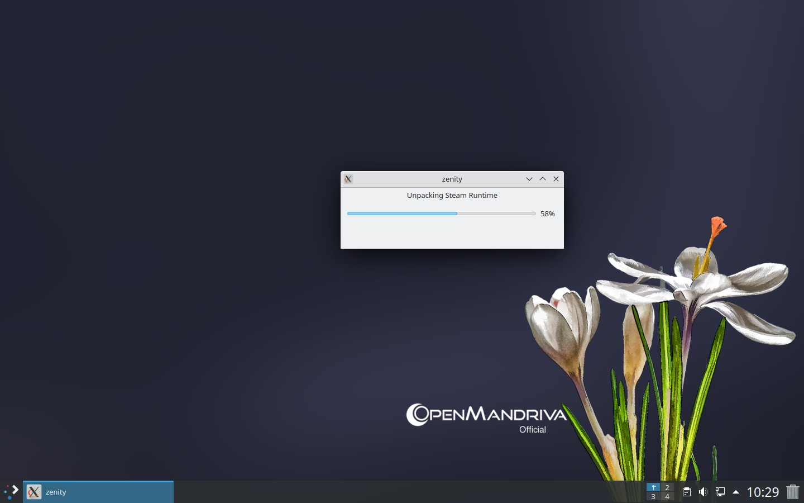
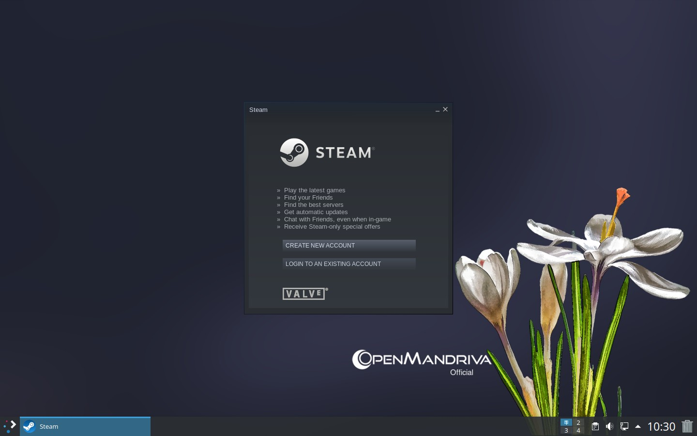
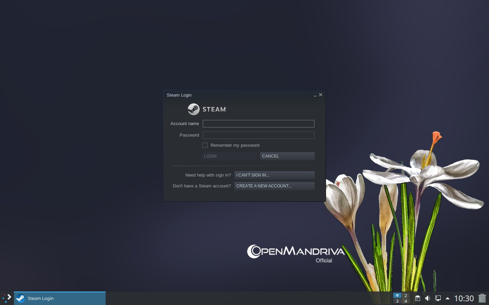

# Install Steam

Steam is a popular digital distribution platform for games. OpenMandriva includes Steam in its repositories---you can install it through OM Welcome or the application menu.

## Install Through OM Welcome

1. Open *OM Welcome*.

1. Navigate to *Applications > Games*.

1. Click *Steam*.







## Install Through the Application Menu

1. Open the *Application Menu*.

1. Navigate to *Games > Steam*.

   

   

   

   

   

   

   

### NVIDIA Graphics Driver

If you use an NVIDIA graphics card, install the 32-bit version of the driver so Steam can run 32-bit games:

```bash
$ sudo dnf clean all; dnf clean all; dnf repolist
$ sudo dnf install --enablerepo=rock-x86_64-non-free nvidia-32bit
```

For older NVIDIA cards, use the legacy driver instead:

```bash
$ sudo dnf install --enablerepo=rock-x86_64-non-free nvidia-legacy-32bit
```

## Related Topics

- [Managing Software](../software.en.html)
- [Using DNF](./using-dnf.en.html)
