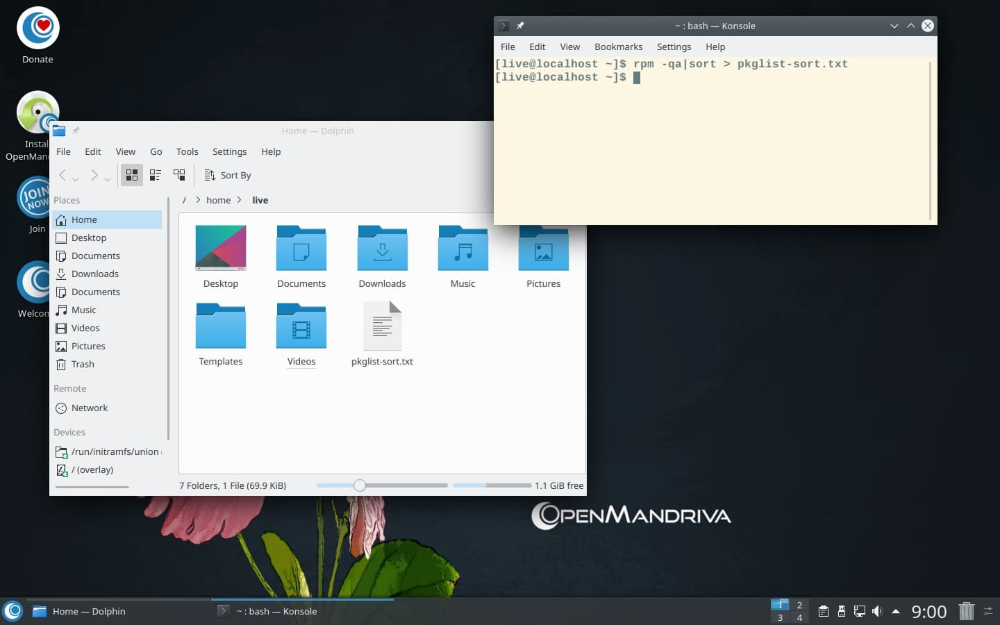

# List Packages in the ISO

You may need to see which packages are included in your OpenMandriva installation---for example, to compare a live USB with your installed system or to audit what ships in the ISO.

## Generate a Sorted Package List

In a terminal, run:

```bash
rpm -qa|sort > pkglist-sort.txt
```

This creates a text file named `pkglist-sort.txt` in your home directory, listing all installed packages sorted alphabetically.



> **Note:** This trick works on installed systems too---not just in live or ISO mode. You can run the command any time you need a package list.
{: .note }

## List Packages by Installation Date

To sort the list by installation date instead of alphabetical order:

```bash
rpm -qa --last > pkglist-last.txt
```

## Related Topics

- [Using DNF](./using-dnf.en.html)
- [Maintaining Your System](../maintaining/index.en.html)
