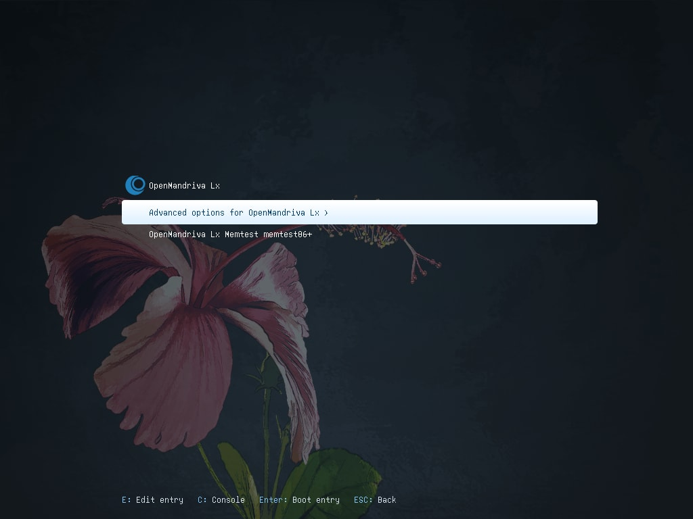
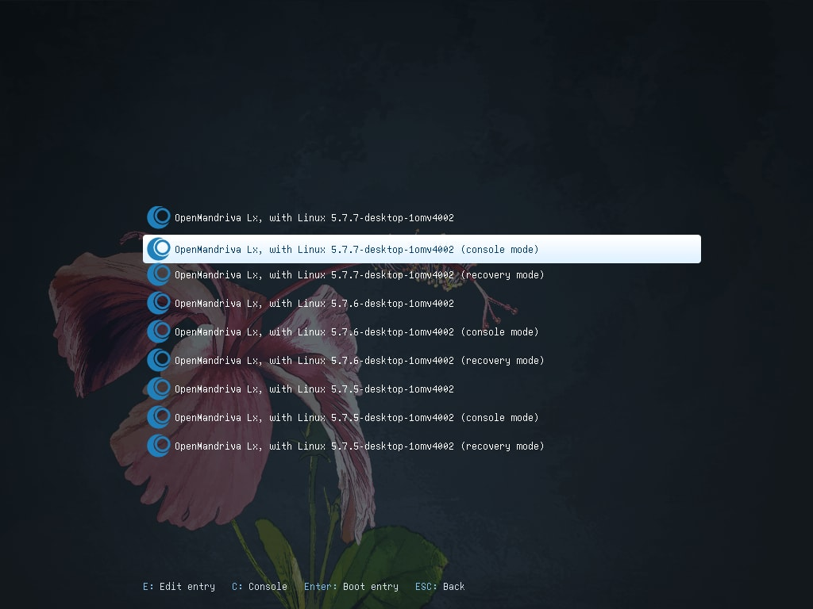
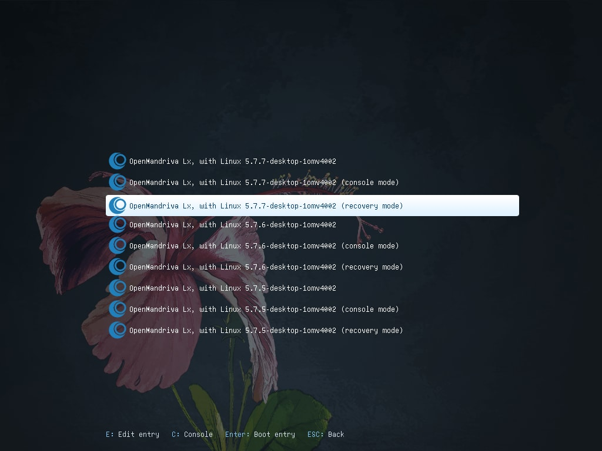

# Connect to the Internet in Recovery Mode

Sometimes you need to boot into console or recovery mode---for example, to perform maintenance or repair. In these modes, Wi-Fi may not work automatically. This guide shows you how to connect using the command line.

> **Note:** This guide assumes your internet was working before something went wrong. It will not help if networking was never configured.
{: .note }

## Boot Into Console or Recovery Mode

1. At the GRUB boot menu, press <kbd>E</kbd> to edit the boot entry.

   

1. Find the line starting with `linux` and add a `3` to the end to boot into console mode.

   

1. Alternatively, select *Advanced options* and then *Recovery mode*.

   

## Connect via Wi-Fi

Use the `nmcli` command to manage network connections from the command line.

1. List available network devices:

   ```bash
   $ nmcli dev status
   ```

   This shows network devices such as `wifi`, `wifi-p2p`, and `ethernet`. Identify your Wi-Fi device name---for example, `wlp4s0`.

1. Connect to a Wi-Fi network:

   ```bash
   $ nmcli --ask dev con wlp4s0
   ```

   Replace `wlp4s0` with your device name. The `--ask` flag prompts you for the Wi-Fi password.

1. Verify the connection:

   ```bash
   $ nmcli dev status
   ```

   The device should show as `connected`.

## Connect via Ethernet

If you use an ethernet cable, the connection usually activates automatically:

```bash
$ nmcli dev status
```

If your ethernet device---for example `elp4s0`---shows as disconnected, connect it:

```bash
$ nmcli dev con elp4s0
```

The `--ask` option is not needed for ethernet, since the system already has permission.

## Related Topics

- [Fix a Broken Bootloader](./fix-bootloader.en.html)
- [Maintaining Your System](../maintaining/index.en.html)
